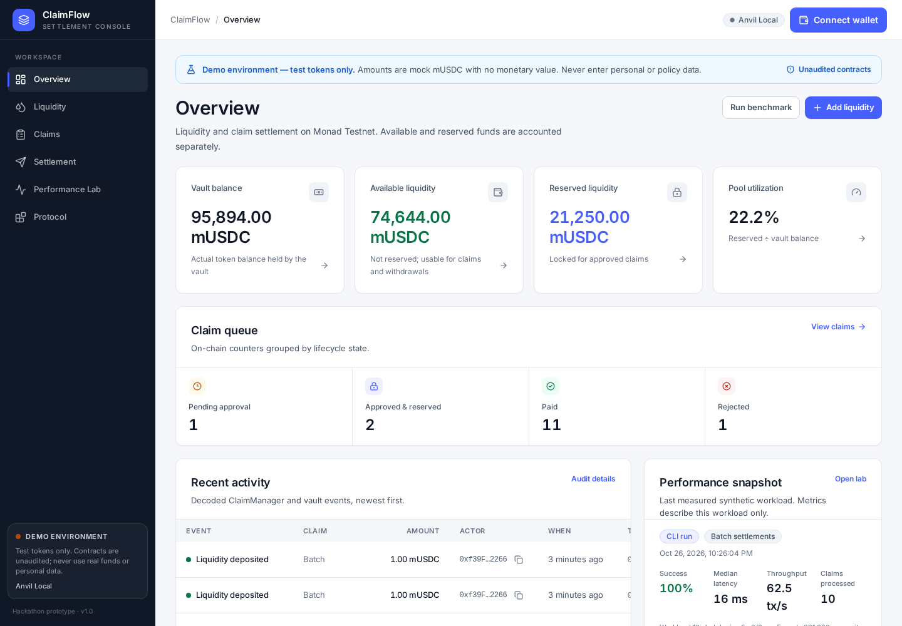

# ClaimFlow

**Liquidity and claim-settlement console for Monad Testnet.** ClaimFlow is a hackathon
prototype: liquidity providers deposit a mock USDC token, authorized operators submit opaque
claims, approvers reserve liquidity atomically, and settlement operators pay one claim or an
all-or-nothing batch. Every state change emits an on-chain event that the UI decodes without a
backend.

> **Demo only.** Mock tokens, synthetic data, unaudited contracts, Monad Testnet (or a local
> Anvil chain). Never use real funds, real stablecoins, or personal data.



## Contents

- [What is implemented](#what-is-implemented)
- [Quick start](#quick-start)
- [Environment variables](#environment-variables)
- [Commands](#commands)
- [Testing](#testing)
- [Deploy to Monad Testnet](#deploy-to-monad-testnet)
- [Architecture](#architecture)
- [Roles and claim lifecycle](#roles-and-claim-lifecycle)
- [Performance lab](#performance-lab)
- [Security, privacy, and limitations](#security-privacy-and-limitations)
- [Documentation](#documentation)

## What is implemented

| Area                                                                                      | Status                                              |
| ----------------------------------------------------------------------------------------- | --------------------------------------------------- |
| Mock mUSDC with capped faucet (100,000 per request, 1-hour cooldown, 500,000 cap)         | Implemented                                         |
| Liquidity vault with shares, available/reserved accounting, available-only withdrawals    | Implemented                                         |
| Claim submission, listing, filtering, detail timeline, approval/rejection/cancellation    | Implemented                                         |
| Single and batch settlement (default cap 20, admin-configurable up to 50), all-or-nothing | Implemented                                         |
| Role-aware UI plus contract-enforced access control                                       | Implemented                                         |
| Receipt-gated transaction states, wallet rejection and RPC/permission/liquidity errors    | Implemented                                         |
| Explorer links, copyable addresses/hashes, CSV export                                     | Implemented                                         |
| In-app benchmark runner and Node CLI benchmark with JSON/CSV export                       | Implemented                                         |
| Local Anvil deployment and seed; Monad Testnet deployment scripts                         | Implemented; testnet deployment awaits a funded key |
| P1 risk-pool segmentation                                                                 | Deferred (documented in `PLAN.md`)                  |
| P2 evidence portal, external integrations, dedicated indexer                              | Out of scope                                        |

The PRD is the functional source of truth and the design document is the visual source of truth.
Conflicts and resolutions are listed in [`PLAN.md`](PLAN.md) (notably the indigo lock badge for
`Approved & Reserved`, dual benchmark delivery, and English UI copy).

## Quick start

### Prerequisites

- Node.js 22+ and pnpm 12 (`corepack enable`)
- [Foundry](https://book.getfoundry.sh/getting-started/installation) (`forge`, `anvil`, `cast`)
- A browser with an injected EVM wallet for write flows (MetaMask, Rabby, etc.)

### Local demo (recommended)

```bash
pnpm install
pnpm dev:local
```

`pnpm dev:local` builds the contracts, starts Anvil if it is not already running, deploys and seeds
the protocol, writes `frontend/.env.local` with public addresses, and starts Vite at
<http://localhost:5173>.

The local deployment enables self-approval on purpose so one wallet can complete the whole flow.
Anvil account #0 is the deployer and holds every role. Import this **public development key** into
your wallet only for local use:

```text
0xac0974bec39a17e36ba4a6b4d238ff944bacb478cbed5efcae784d7bf4f2ff80
```

Select the `Anvil Local` network (chain ID `31337`, RPC `http://127.0.0.1:8545`) if your wallet does
not add it automatically.

### Manual local flow

```bash
# Terminal 1
pnpm anvil

# Terminal 2
pnpm contracts:build
pnpm deploy:local      # deploy + seed + write frontend/.env.local
pnpm dev
```

Generated deployment records live in `deployments/<chainId>.json` and are gitignored. The local
record contains only public values.

## Environment variables

Copy `.env.example` to `.env` for deployment and benchmark scripts. Copy `frontend/.env.example` to
`frontend/.env.local` for the app, or let the deploy script write it.

| Variable                                                                                            | Used by          | Notes                                                                                                 |
| --------------------------------------------------------------------------------------------------- | ---------------- | ----------------------------------------------------------------------------------------------------- |
| `PRIVATE_KEY`                                                                                       | deploy/benchmark | Required only for Monad Testnet. Dedicated funded testnet key. Never commit.                          |
| `MONAD_RPC_URL`                                                                                     | scripts          | Defaults to `https://testnet-rpc.monad.xyz`.                                                          |
| `LOCAL_RPC_URL`                                                                                     | scripts          | Defaults to `http://127.0.0.1:8545`.                                                                  |
| `DEPLOYER_ADDRESS`                                                                                  | local scripts    | Defaults to the public Anvil account #0.                                                              |
| `CLAIM_OPERATOR_ADDRESS`, `CLAIM_APPROVER_ADDRESS`, `SETTLEMENT_ADDRESS`, `CLAIM_CANCELLER_ADDRESS` | deploy           | Optional; default to the deployer. Use separate wallets to exercise the default separation of duties. |
| `ALLOW_SELF_APPROVAL`                                                                               | deploy           | Defaults to `true` locally and `false` on testnet.                                                    |
| `MAX_BATCH_SIZE`                                                                                    | deploy           | 1–50, default 20.                                                                                     |
| `VITE_CHAIN_ID`, `VITE_CHAIN_NAME`, `VITE_RPC_URL`, `VITE_EXPLORER_URL`                             | frontend         | Public network configuration.                                                                         |
| `VITE_MOCK_USDC_ADDRESS`, `VITE_VAULT_ADDRESS`, `VITE_CLAIM_MANAGER_ADDRESS`                        | frontend         | Required; deployment writes them. The app refuses to invent addresses.                                |
| `VITE_DEPLOYMENT_BLOCK`                                                                             | frontend         | First block scanned for events.                                                                       |
| `VITE_WALLETCONNECT_PROJECT_ID`                                                                     | frontend         | Optional; enables WalletConnect in addition to injected wallets.                                      |
| `VITE_BENCHMARK_PROVIDER_LABEL`                                                                     | frontend         | Optional display label for the benchmark environment.                                                 |

`VITE_*` values are public and embedded in the client bundle. Never place a private key in a `VITE_`
variable.

## Commands

| Command                                                                       | Description                                                             |
| ----------------------------------------------------------------------------- | ----------------------------------------------------------------------- |
| `pnpm dev`                                                                    | Start the frontend (expects a deployment in `frontend/.env.local`).     |
| `pnpm dev:local`                                                              | Full local demo: Anvil, contracts, deploy, seed, frontend.              |
| `pnpm build`                                                                  | Typecheck and production build.                                         |
| `pnpm lint`                                                                   | ESLint with zero warnings allowed.                                      |
| `pnpm typecheck`                                                              | TypeScript strict check.                                                |
| `pnpm test`                                                                   | Vitest unit/component tests.                                            |
| `pnpm test:e2e`                                                               | Playwright E2E against the running local deployment.                    |
| `pnpm contracts:build` / `pnpm contracts:test`                                | Foundry build / full test suite.                                        |
| `pnpm deploy:local`                                                           | Deploy + seed on Anvil and write frontend env.                          |
| `pnpm deploy:testnet`                                                         | Deploy to Monad Testnet using `PRIVATE_KEY`.                            |
| `pnpm seed:testnet`                                                           | Seed the testnet deployment (optional demo data).                       |
| `pnpm benchmark --network local --operation settle-batch --size 10 --batch 5` | CLI benchmark.                                                          |
| `pnpm sync:abis`                                                              | Regenerate `frontend/src/lib/abis.generated.ts` from Foundry artifacts. |
| `pnpm format` / `pnpm format:check`                                           | Prettier for frontend/docs (Tailwind class sorting).                    |
| `pnpm contracts:fmt` / `pnpm contracts:fmt:check`                             | Forge formatting for Solidity.                                          |
| `pnpm check`                                                                  | Lint, typecheck, unit tests, contract tests, build.                     |

## Testing

### Contracts

```bash
export PATH="$PATH:$HOME/.foundry/bin"
pnpm contracts:test
```

**62 Foundry tests** cover unit, fuzz, and invariant behavior: capped faucet, share pricing,
available-only withdrawals, atomic approval/reservation, insufficient liquidity, role checks,
duplicate/zero/invalid inputs, cancellation and release, single payout, double-payout protection,
batch settlement and full-batch rollback, reentrancy, and `balance >= totalReserved` invariants.

### Frontend

```bash
pnpm test              # 67 Vitest tests
pnpm test:e2e          # 7 Playwright tests (requires Anvil + local deployment)
```

Vitest covers formatting, validation, error classification, filtering and available actions,
CSV escaping, liquidity math, benchmark metrics, and key UI states. Playwright injects an EIP-1193
provider backed by the public Anvil account, then verifies read-only flows, mobile navigation, and a
real `approve → deposit` transaction pair.

For E2E, start the demo first (`pnpm dev:local`) or start Anvil and deploy separately. The tests skip
themselves when the RPC is unreachable.

## Deploy to Monad Testnet

1. Create a dedicated testnet wallet and fund it from <https://faucet.monad.xyz>.
2. Copy `.env.example` to `.env` and set `PRIVATE_KEY`, optionally distinct role addresses, and
   `ALLOW_SELF_APPROVAL=false`.
3. Run:

```bash
pnpm contracts:build
pnpm deploy:testnet
pnpm seed:testnet       # optional demo liquidity/claims
pnpm build
```

The script verifies chain ID `10143`, refuses to deploy with a zero balance, writes
`deployments/10143.json`, and writes public addresses to `frontend/.env.local`. It never logs the
private key.

**Status:** no funded Monad Testnet key was available in this environment, so the testnet deployment
was not executed here. The local Anvil deployment and the full flow are verified. This is the one
acceptance item marked partial in [`CHECKLIST.md`](CHECKLIST.md).

## Architecture

```text
┌──────────────────────────── Frontend (React + Vite) ────────────────────────────┐
│ wagmi / viem wallet ── writes ──┐                                               │
│ public RPC reads ───────────────┼── TanStack Query ── feature pages/components   │
│ event logs + block timestamps ──┘                                               │
└─────────────────────────────────┼───────────────────────────────────────────────┘
                                  │
┌──────────────────────────── Monad / Anvil ──────────────────────────────────────┐
│ MockUSDC (faucet, minter role)                                                  │
│ LiquidityVault (shares, available = balance − reserved, reserve/release/payout) │
│ ClaimManager (roles, claim state machine, atomic approval, batch settlement)    │
└─────────────────────────────────────────────────────────────────────────────────┘
```

### Contracts

- **`MockUSDC.sol`** — 6-decimal ERC-20 with a capped faucet, per-address cooldown and lifetime cap,
  and a `MINTER_ROLE`.
- **`LiquidityVault.sol`** — share accounting based on **available** liquidity. `reserve`,
  `release`, and `payout` are restricted to the ClaimManager role. Withdrawals can never touch
  reserved funds. A deposit is blocked while shares exist and available liquidity is zero.
- **`ClaimManager.sol`** — role-gated claim lifecycle. Approval changes status and reserves in one
  transaction. Settlement deletes the reservation before transferring and is `nonReentrant`.
  Batch settlement validates the whole batch, rejects duplicates, and reverts atomically. The batch
  cap defaults to 20 and is admin-configurable (1–50). Self-approval is disabled by default.

### Frontend

```text
frontend/src/
├── app/              providers and routes
├── components/       design system, layout, wallet, transaction states, data display
├── features/         overview, liquidity, claims, settlement, benchmark, protocol
├── hooks/            TanStack Query reads for pool, claims, roles, events, benchmark reports
├── lib/              chain/contracts, ABIs, validation, formatting, errors, CSV,
│                     benchmark metrics/runner/storage, event decoding
├── styles/           centralized tokens via Tailwind theme + CSS layers
└── test/             Vitest setup
frontend/e2e/         Playwright specs and injected EIP-1193 fixture
```

There is no backend. Event history is read from the configured deployment block with `eth_getLogs`;
this is adequate for a demo but not a scalable indexer. P2 intentionally excludes a dedicated
indexer.

## Roles and claim lifecycle

| Role                            | Capability                                                          |
| ------------------------------- | ------------------------------------------------------------------- |
| Liquidity Provider (any wallet) | Faucet, deposit, withdraw own shares                                |
| `CLAIM_OPERATOR_ROLE`           | Submit claims; cancel own pending claims                            |
| `CLAIM_APPROVER_ROLE`           | Approve + reserve, or reject pending claims                         |
| `SETTLEMENT_ROLE`               | Settle a single claim or a batch                                    |
| `CLAIM_CANCELLER_ROLE`          | Cancel pending claims; cancel reserved claims and release liquidity |
| `DEFAULT_ADMIN_ROLE`            | Grant roles, set batch cap, toggle demo self-approval               |

```text
None ──submit──▶ Pending ──approve + reserve──▶ Approved & Reserved ──settle──▶ Paid
                    │                                   │
                    ├──reject──▶ Rejected               └──cancel──▶ Cancelled (reserved released)
                    └──cancel──▶ Cancelled
```

Terminal states are immutable. The UI hides actions a wallet cannot perform, but the contract is the
authority for every check.

## Performance lab

The lab sends explicit synthetic workloads and records per-sample receipt latency, gas, status, and
observed throughput:

- `read` — sequential vault reads (no wallet, no gas)
- `submit` — independent claim submissions
- `settle-single` — sequential single settlements, with setup excluded from measurements
- `settle-batch` — all-or-nothing batches, with setup excluded

Results are available in the UI, persisted in `localStorage`, and exportable as CSV/JSON. The CLI
script emits the same schema and can publish `frontend/public/benchmark/latest.json`:

```bash
node scripts/benchmark.mjs --network local --operation settle-batch --size 10 --batch 5 --publish
```

The committed reference report is a real local Anvil run (10 claims in 2 batches, 391,030 total gas,
100% success). It describes **that** workload and environment only; it is not a Monad capacity
claim. See [`docs/benchmark.md`](docs/benchmark.md) for metric definitions and limitations.

## Security, privacy, and limitations

- Contracts are **unaudited** and intended for testnet demos only.
- No PII fields exist: claims store only hashes, numeric codes, recipient addresses, and amounts.
- Roles are enforced on-chain; UI gating is a convenience, not a security boundary.
- All writes wait for a receipt before showing confirmed state. Read failures are shown as errors,
  never as zero values.
- No private keys, RPC secrets, or policy data are committed. Local E2E uses the publicly known
  Anvil account.
- Batch cap and self-approval policy are admin-controlled; verify them on the Protocol page.
- Event scanning from a deployment block does not scale indefinitely; a production deployment needs
  an indexer (P2).
- Risk-pool segmentation (P1) is deferred because it would change the vault accounting model. The
  rationale and all assumptions are recorded in [`PLAN.md`](PLAN.md).
- The UI is English; the source documents are Indonesian/English. Copy was translated faithfully.

## Documentation

- [`PLAN.md`](PLAN.md) — discovery, conflicts, assumptions, milestones, traceability.
- [`CHECKLIST.md`](CHECKLIST.md) — acceptance criteria with verification evidence.
- [`docs/deployment.md`](docs/deployment.md) — local and testnet deployment, troubleshooting.
- [`docs/demo-script.md`](docs/demo-script.md) — a repeatable 5-minute demo.
- [`docs/benchmark.md`](docs/benchmark.md) — methodology, schema, committed results, limits.

## License

MIT for the prototype code. Mock assets and synthetic data are not financial products.
